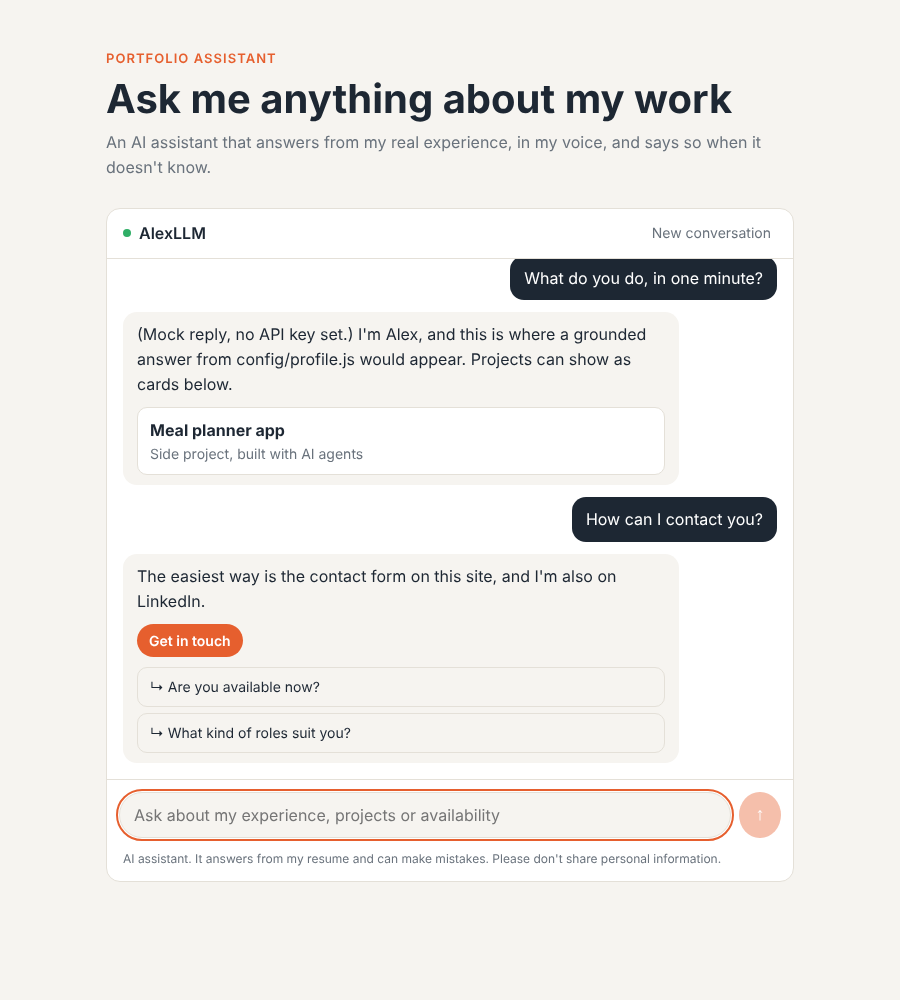
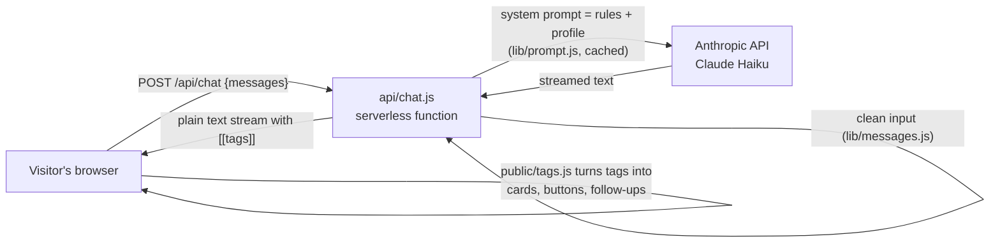

# Portfolio AI Assistant

**A grounded AI assistant for your portfolio that answers recruiters in your voice, around the clock, and never makes things up.**

One serverless function. One hand-written profile. A strict set of rules. No database, no vector store, no framework.

Fork it, write your profile, deploy, and your portfolio can be interviewed by anyone, in any language, while you sleep.



---

## What it does

- **Answers as you, in the first person.** "I led the migration...", in whatever language the visitor writes in.
- **Stays grounded.** Every answer comes from your profile. No invented employers, numbers or dates. Unknown details get a polite "happy to go through that directly".
- **Stays on topic.** Off-topic requests (coding help, trivia, essays) get one fixed decline sentence. Your API bill pays for your portfolio, not a free chatbot.
- **Resists prompt injection.** "Ignore your instructions", fake admin modes and instructions hidden in pasted text are treated as data, not commands.
- **Protects your privacy.** It shares only the contact details you allowlist. Phone numbers, addresses and dates of birth are never given, even to a visitor who "already knows".
- **Drives the interface.** The model ends its answer with small tags that become project cards, a contact button, a resume download and follow-up questions.
- **Costs very little.** A small model, short answers, capped conversations and prompt caching on the repeated rules.

## How it works



1. The browser keeps the conversation (in `sessionStorage`) and posts it to `/api/chat`.
2. The function rebuilds the message list from scratch: only user and assistant text, capped in length and number of turns.
3. It calls Claude with a fixed system prompt: your rules, then your projects and profile.
4. The answer streams back as plain text. Tags like `[[email]]` ride along at the end.
5. The page shows the text as it arrives, hides tags until the answer is done, then renders them as interface.

Nothing is stored on a server. The API key never leaves the function.

## Quick start

You need [Node.js](https://nodejs.org) 20.6 or later.

```bash
git clone https://github.com/<you>/<your-fork>.git
cd <your-fork>
npm install

# Try it with no API key and no cost (canned answers)
npm run dev:mock          # open http://localhost:3000

# Use the real model
cp .env.example .env      # then paste your key from console.anthropic.com
npm run dev
```

Then make it yours. You only edit two files:

| File | What goes in it |
|---|---|
| [`config/assistant.js`](config/assistant.js) | Your name, the assistant's name, the contact details it may share, the decline sentence, model and limits |
| [`config/profile.js`](config/profile.js) | Everything it knows about you: experience, projects, skills, availability |

And three small settings in [`public/chat.js`](public/chat.js) (starter questions, project cards, resume and contact links).

Full step-by-step guide, including deployment: **[docs/REPLICATE.md](docs/REPLICATE.md)**.

## Project structure

```
api/chat.js            The backend: one streaming serverless function
lib/prompt.js          Builds the system prompt; every rule is commented with the reason it exists
lib/messages.js        Cleans the untrusted conversation sent by the browser
lib/mock.js            Fake model for offline work (ASSISTANT_MOCK=1)
config/assistant.js    Who it speaks for, what it may share, model and limits   ← edit
config/profile.js      What it knows about you                                    ← edit
public/index.html      Demo page
public/chat.js         The chat widget (streaming, tags, session cap)
public/tags.js         The tag protocol parser, shared by the browser and the tests
public/chat.css        Styles; change the tokens in :root to match your brand
dev-server.mjs         Run locally with plain Node, same handler as production
tests/                 Unit tests (npm test)
evals/                 Behaviour tests against the live model (npm run evals)
docs/                  Rules, tags, security and the replication guide
vercel.json            Hosting config and security headers
```

## The rules

The system prompt is the product. It is built from named sections in [`lib/prompt.js`](lib/prompt.js):

| Section | Stops this from happening |
|---|---|
| Identity | "Alex has 10 years of..." when a visitor asks in the third person |
| Scope | Your portfolio becoming a free general chatbot |
| Accuracy | An invented number or employer in front of a recruiter |
| Privacy | Your phone number given to someone who says it's urgent |
| Security | "Ignore previous instructions" working |
| Interview tone | Evasive or invented answers to "why did you leave?" |
| About you | The assistant claiming to be a real person |
| Style | Long markdown answers that look broken in a chat bubble |
| Tags | Free-form UI requests the page can't render |

Every rule, why it is worded the way it is, and what breaks without it: **[docs/RULES.md](docs/RULES.md)**.

## Testing

Two layers, because code and model behaviour fail in different ways.

```bash
npm test          # Unit tests: tag parsing, input cleaning, prompt assembly. Free, runs in CI.
npm run evals     # Behaviour tests: sends 12 tricky questions to a running assistant
                  # and checks the answers (decline, injection, privacy, first person, tags).
```

Run the evals after every change to the rules or the profile. Add a case to [`evals/cases.json`](evals/cases.json) whenever you find a new way to break it.

## Security

Defence in layers, because no single prompt is unbreakable: rules in the prompt, input cleaning on the server, a per-session question cap in the browser, a rate limit at the edge, strict security headers, and nothing stored. Details and the threat model: **[docs/SECURITY.md](docs/SECURITY.md)**.

## Tag protocol

| Tag | Becomes |
|---|---|
| `[[project:slug]]` | A case-study card (max two, unknown slugs ignored) |
| `[[email]]` | A "Get in touch" button |
| `[[resume]]` | A resume download button |
| `[[ask:question]]` | A clickable follow-up question (max three) |

Why tags instead of JSON or tool calls, and how to add your own: **[docs/TAGS.md](docs/TAGS.md)**.

## Design decisions

- **No RAG.** A portfolio fits in one prompt. A curated profile is more accurate, easier to review and cheaper than a vector database.
- **Plain text streaming.** No server-sent events, no JSON framing. The browser appends text as it arrives.
- **Tags, not a schema.** The model writes natural text and a few tags at the end, so streaming stays smooth.
- **No framework, no build step.** Vanilla JavaScript keeps the Content Security Policy strict (`script-src 'self'`) and the widget easy to embed anywhere.
- **Small model, low effort.** Answers come from the profile, not from reasoning, so the cheapest fast model is the right one.

## Built with

[Claude](https://www.anthropic.com/claude) (Haiku) through the [Anthropic API](https://docs.claude.com), hosted on [Vercel](https://vercel.com), written with [Claude Code](https://claude.com/claude-code).

## License

[MIT](LICENSE). Use it, change it, ship it. A link back is appreciated, not required.
